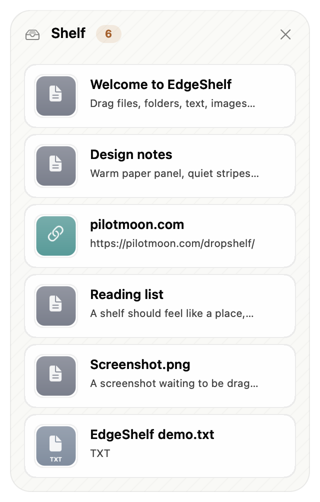

# EdgeShelf

**English** | [中文](README.zh-CN.md)

[](https://github.com/tianyk/EdgeShelf/actions/workflows/build.yml)



EdgeShelf is a small drag-and-drop shelf for macOS 26/27 — a clean-room
reimplementation of [Dropshelf](https://pilotmoon.com/dropshelf/).

Drag a file, folder, image, link, or text snippet to the left or right edge
of the screen. A shelf appears and keeps the item until you drag it somewhere
else.

The original Dropshelf (build 1729, 2021) can beachball on macOS 26 because
of Core Drag reentrancy; see [DROPSHELF-NOTES.md](DROPSHELF-NOTES.md) for the
diagnosis.

## Features

- Drag files, folders, text, images, and links to the left or right edge.
- Items reference the original file or folder instead of copying it, so even a
  huge file lands on the shelf instantly and uses no extra disk space.
- Each file item is watched with a kqueue vnode watcher: deleting the original
  (including moving it to the Trash) removes the card immediately, while a
  rename or move within the volume updates the card’s path and name.
- Pasted images and files received through a file promise are stored in
  `~/Library/Application Support/EdgeShelf/Items`; everything else stays in
  place.
- Dynamic shelf height (220–560 pt), frozen while a drag is in flight.
- Warm paper light theme and graphite dark theme, with a terracotta accent,
  quiet diagonal stripes, and a soft outer shadow.
- 64 pt cards with type-coloured thumbnails, real image previews, file name,
  type, and size; hover reveals the remove button.
- Collapses to an 8 × 96 pt gradient tab at the edge as soon as the pointer
  leaves; hover the edge to expand it again.
- Right-click menu: Open, Show in Finder, Copy, Remove — with keyboard
  shortcuts — plus Clear Shelf for the whole shelf.
- Six UN languages plus “Follow System”.
- No Accessibility, Input Monitoring, or Screen Recording permission required.
- No `CGWindowListCreate`, no synchronous XPC, no `NSTask` on the main thread.
- The product name **EdgeShelf** is intentionally never translated.

## Languages

Choose **Preferences → Language**:

| Language | Native name | Layout |
|---|---|---|
| Follow System | — | system |
| English | English | LTR |
| Chinese | 中文 | LTR |
| French | Français | LTR |
| Spanish | Español | LTR |
| Russian | Русский | LTR |
| Arabic | العربية | RTL shelf |

The default is **Follow System**, which resolves to one of the six languages
above (falling back to English). The shelf mirrors its header and cards for
Arabic; secondary windows and system menus follow the system layout direction.

Arabic preview: [`docs/screenshot-ar.png`](docs/screenshot-ar.png).

## UI

- 300 pt panel; height follows the item count (220–560 pt) and is frozen while
  a drag is in flight.
- Warm paper light theme and graphite dark theme, with a terracotta accent,
  very quiet diagonal stripes, and a soft outer shadow.
- 64 pt item cards with a type-coloured thumbnail, file name, type, and size;
  hover reveals the remove button.
- Collapses to an 8 × 96 pt terracotta gradient tab at the edge with a soft
  glow; hover the edge to expand. Preview: [`docs/tab.png`](docs/tab.png).
- All user-facing copy lives in [`Sources/L10n.swift`](Sources/L10n.swift).

## Build

```bash
./build.sh              # current architecture
UNIVERSAL=1 ./build.sh  # arm64 + x86_64 universal
open build/EdgeShelf.app
```

Requires Xcode 26 (or the matching command line tools). The app is ad-hoc
signed. On another Mac, right-click → Open the first time.

## GitHub Actions

[`.github/workflows/build.yml`](.github/workflows/build.yml) builds a
universal app on every push to `main` and every pull request, runs the
self-test, and uploads `EdgeShelf-<sha>.zip`, `.dmg`, and SHA-256 checksums as
a workflow artifact.

Push a tag to create a GitHub Release with the same assets:

```bash
git tag v0.1.0
git push origin v0.1.0
```

The build is ad-hoc signed and **not notarized**. For distribution outside your
own Macs, add a Developer ID certificate and a notarization step (for example
with `MACOS_CERTIFICATE`, `MACOS_CERTIFICATE_PASSWORD`, `APPLE_ID`,
`APPLE_TEAM_ID`, and `APPLE_APP_PASSWORD` secrets), then `codesign` and
`notarytool` the `.app` before packaging.

## Usage

- Drag something to the left or right screen edge. A shelf appears.
- Drop it; the shelf points at the original file instead of copying it.
- Move away and the shelf collapses to the edge tab immediately.
- Hover the edge tab to expand the shelf again.
- Right-click an item for Open / Show in Finder / Copy / Remove.
- Drag an item out to Finder, Mail, Slack, etc. The drag uses the original
  path and is a copy operation, so the source file stays where it is.
- Menu bar → Preferences for edges, behaviour, and language.

Copies made by older versions are removed on first launch when the original
still exists. A copy whose original is already gone is kept, because it is the
only remaining content.

## Test

```bash
# Data model + pasteboard + stored payloads + file watcher
build/EdgeShelf.app/Contents/MacOS/EdgeShelf --self-test

# Add demo items and show the left shelf
open build/EdgeShelf.app --args --demo

# Render the shelf to /tmp/edgeshelf-snapshot.png without screen capture
build/EdgeShelf.app/Contents/MacOS/EdgeShelf --snapshot

# Force a language for a screenshot or manual check
build/EdgeShelf.app/Contents/MacOS/EdgeShelf --lang en --snapshot --snapshot-many
```

`--demo`, the `--snapshot*` modes, `--self-test` and the `--debug-*`
printers run against a throwaway store under `$TMPDIR/EdgeShelf-Debug`, so
they never touch the shelves you actually use.

## Manual checklist

1. Drag a file from Finder to the left edge. A shelf appears; drop the file.
2. Move away. The shelf collapses to a tab immediately.
3. Move to the edge tab. The shelf expands.
4. Drag the file from the shelf back to its original folder. No “replace?”
   prompt.
5. Rename the file in Finder; the card’s name and path update.
6. Delete the original file in Finder; the card disappears from the shelf.
7. Drag text from a browser/editor to the right edge.
8. Right-click an item; try Open, Show in Finder, and Copy.
9. Change the language in Preferences; the shelf and preferences update
   immediately.
10. Quit and relaunch; shelves, items, and the language choice come back.

## Known limitations

- One shelf per edge per display. Dropshelf allows several shelves stacked
  along the same edge.
- Top and bottom edges are not implemented yet.
- No Quick Look panel, “Open With” submenu, or multi-select yet.
- Renames and moves are followed while the app is running and the file stays
  on the same volume. A move made while the app is not running, or a move to
  another volume, is treated as a deletion. Items on an unmounted volume are
  kept until the volume is back.
- Renaming a folder that contains the item is picked up at the next launch,
  wake, or mount; the item’s own vnode does not report ancestor changes.
- Some network volumes do not deliver kqueue events. On those, changes are
  noticed at launch, wake, or mount/unmount, not immediately.
- Shelf state is keyed by display ID. If a display gets a different ID after
  reconnecting, its shelf items are not shown on the new display.
- Arabic mirrors the shelf header and cards; the preferences window and the
  status menu follow the system layout direction.
- The app is not notarized. It is built and signed locally.

## Project layout

```
Sources/
  main.swift                      entry point, self-test
  AppDelegate.swift               menu bar item and app lifecycle
  DragMonitor.swift               global mouse drag detection + edge polling
  ShelfManager.swift              state, persistence, edge windows, ingest
  ShelfWindow.swift               fixed-frame edge window, presentation states
  ShelfView.swift                 shelf panel and item cards
  Theme.swift                     metrics, palette, background, tab, empty state
  L10n.swift                      all UI strings and the six language tables
  FileWatcher.swift               kqueue watcher for deletes/renames/moves
  Store.swift                     JSON state + stored image/promise payloads
  Models.swift                    ShelfItem/ShelfState/ShelfEdge
  Preferences.swift               UserDefaults
  PreferencesWindowController.swift
```

Built with AppKit, no third-party dependencies.
