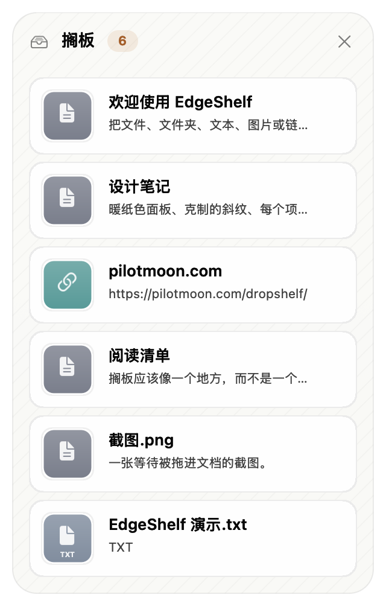

# EdgeShelf

[English](README.md) | **中文**



EdgeShelf 是一个面向 macOS 26/27 的轻量拖拽暂存搁板，也是
[Dropshelf](https://pilotmoon.com/dropshelf/) 的干净重实现。

把文件、文件夹、图片、链接或文本拖到屏幕左/右边缘，搁板会出现并保留这些内容，直到你把它们拖到别处。

原版 Dropshelf（Build 1729，2021 年）在 macOS 26 上可能因为 Core Drag 重入而卡死；诊断记录见
[DROPSHELF-NOTES.md](DROPSHELF-NOTES.md)（英文）。

## 功能

- 把文件、文件夹、文本、图片、链接拖到左/右屏幕边缘。
- 项目会复制到 `~/Library/Application Support/EdgeShelf/Items`，原文件移动或删除后搁板里的项目仍然可用。
- 搁板高度随内容在 220–560pt 之间变化；拖拽过程中冻结高度，避免 macOS 26 的拖拽重入问题。
- 暖纸色浅色主题 / graphite 深色主题，陶土色强调色、克制的斜纹和柔和阴影。
- 64pt 卡片：按类型着色的缩略图、真实图片预览、文件名、类型和大小；悬停显示移除按钮。
- 3 秒后收成边缘 8×96pt 渐变胶囊；鼠标移到边缘再展开。
- 右键菜单：打开、在访达中显示、拷贝、从搁板移除，带快捷键。
- 六种联合国官方语言 +“跟随系统”。
- 不需要辅助功能、输入监控或屏幕录制权限。
- 不使用 `CGWindowListCreate`，主线程不做同步 XPC / `NSTask`。
- 产品名 **EdgeShelf** 始终保留英文，不翻译。

## 语言

在 **偏好设置 → 语言** 中选择：

| 语言 | 本地名称 | 布局 |
|---|---|---|
| 跟随系统 | — | 系统 |
| 英语 | English | LTR |
| 中文 | 中文 | LTR |
| 法语 | Français | LTR |
| 西班牙语 | Español | LTR |
| 俄语 | Русский | LTR |
| 阿拉伯语 | العربية | RTL 搁板 |

默认是 **跟随系统**，会解析为上面六种语言之一（无法识别时回退到英语）。
阿拉伯语会把搁板的头部和卡片镜像为 RTL；偏好设置窗口和系统菜单仍跟随系统布局方向。

阿拉伯语预览：[`docs/screenshot-ar.png`](docs/screenshot-ar.png)。

## 界面

- 300pt 面板；高度随项目数量在 220–560pt 之间变化，拖拽中冻结。
- 暖纸色浅色主题 / graphite 深色主题，陶土色强调色、轻微斜纹和柔和外阴影。
- 64pt 卡片：类型色缩略图、文件名、类型和大小；悬停显示移除按钮。
- 收起后是边缘 8×96pt 陶土色渐变胶囊，带柔光；鼠标移到边缘展开。
  预览：[`docs/tab.png`](docs/tab.png)。
- 所有界面文案集中在 [`Sources/L10n.swift`](Sources/L10n.swift)。

## 构建

```bash
./build.sh
open build/EdgeShelf.app
```

需要 Xcode 26（或对应的命令行工具）。App 使用本地 ad-hoc 签名；换到另一台 Mac 首次打开时右键 → 打开。

## 使用

- 把内容拖到屏幕左/右边缘，搁板出现。
- 松手后项目会复制到 EdgeShelf 的存储目录。
- 鼠标移开 3 秒后收成边缘胶囊；移到胶囊附近再展开。
- 右键项目：打开 / 在访达中显示 / 拷贝 / 从搁板移除。
- 把项目拖到 Finder、邮件、Slack 等。原文件还在时优先使用原始路径，
  所以拖回原文件夹不会弹“是否替换”。
- 菜单栏 → 偏好设置：边缘、行为、语言。

## 测试

```bash
# 数据模型 + 剪贴板 + 存储往返
build/EdgeShelf.app/Contents/MacOS/EdgeShelf --self-test

# 添加演示项目并显示左搁板
open build/EdgeShelf.app --args --demo

# 不截屏，直接把搁板渲染到 /tmp/edgeshelf-snapshot.png
build/EdgeShelf.app/Contents/MacOS/EdgeShelf --snapshot

# 强制语言做截图或手动检查
build/EdgeShelf.app/Contents/MacOS/EdgeShelf --lang zh --snapshot --snapshot-many
```

## 手动测试清单

1. 从 Finder 拖一个文件到左边缘，搁板出现，松手放入。
2. 鼠标移开，约 3 秒后收成边缘胶囊。
3. 移到边缘胶囊，搁板展开。
4. 把文件从搁板拖回原文件夹，不应出现“是否替换”。
5. 从浏览器/编辑器拖一段文本到右边缘。
6. 右键项目，试打开、在访达中显示、拷贝。
7. 在偏好设置里切换语言，搁板和偏好设置立即更新。
8. 退出再启动，搁板、项目和语言选择都恢复。

## 已知限制

- 每条边每个显示器只有一个搁板；Dropshelf 支持同一条边多个搁板。
- 上下边缘还没实现。
- 还没有 Quick Look、打开方式子菜单、多选。
- 超大文件夹复制需要时间，项目会显示“正在复制…”，复制完成前不能拖出。
- 搁板状态按显示器 ID 保存；显示器重连后 ID 变化时，原搁板项目不会显示在新显示器上。
- 阿拉伯语会镜像搁板头部和卡片；偏好设置窗口和状态菜单仍跟随系统布局方向。
- App 没有公证，只在本地构建和签名。

## 项目结构

```
Sources/
  main.swift                      入口、自测
  AppDelegate.swift               菜单栏和 App 生命周期
  DragMonitor.swift               全局鼠标拖拽检测 + 边缘轮询
  ShelfManager.swift              状态、持久化、边缘窗口、接收项目
  ShelfWindow.swift               固定 frame 的边缘窗口、显示状态
  ShelfView.swift                 搁板面板和项目卡片
  Theme.swift                     尺寸、配色、背景、胶囊、空状态
  L10n.swift                      所有界面文案和六种语言表
  Store.swift                     JSON + 项目文件存储
  Models.swift                    ShelfItem/ShelfState/ShelfEdge
  Preferences.swift               UserDefaults
  PreferencesWindowController.swift
```

使用 AppKit 构建，无第三方依赖。
